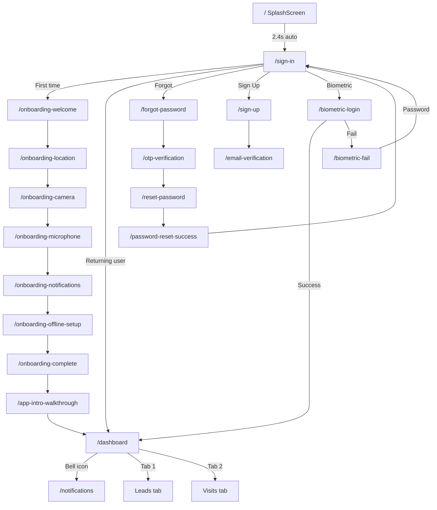
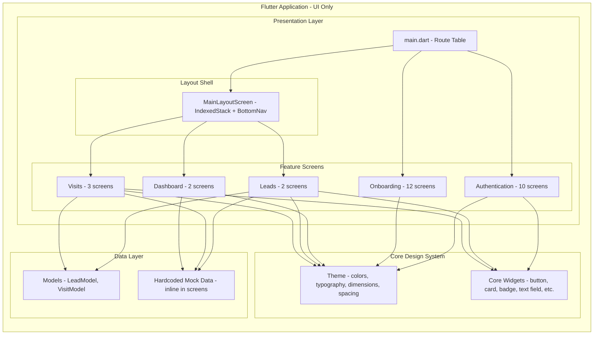
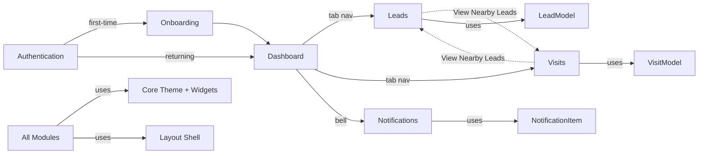
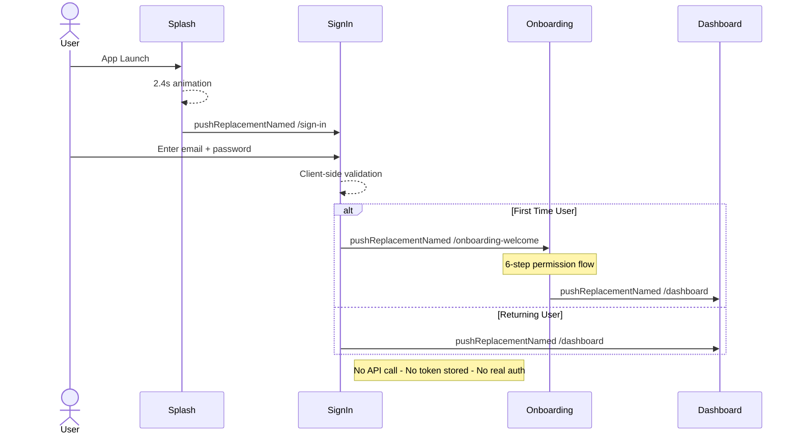

# CRM Pro Field Sales — Complete Application Analysis

---

## 24. EXECUTIVE SUMMARY

| Attribute | Value |
|---|---|
| **Application Name** | CRM Pro Field Sales |
| **Package Name** | `crm_mobile_test` |
| **Version** | 1.0.0+1 |
| **Dart SDK** | ^3.12.0 |
| **Architecture Style** | Feature-first folder structure; **UI-only prototype** with no backend, no services, no repositories |
| **Modules Identified** | 5 (Authentication, Onboarding, Dashboard, Leads, Visits) |
| **Screens Identified** | ~30 (including alias/route duplicates for the same widget) |
| **API Endpoints Identified** | **0** — No network calls exist anywhere in the codebase |
| **State Management** | `setState` exclusively (StatefulWidget) |
| **Networking** | **None** — No HTTP client, Dio, Retrofit, or any networking package |
| **Storage** | **None** — No SharedPreferences, Hive, SQLite, or any persistence |
| **Authentication** | UI-only; simulated via callback navigation, no real auth |
| **Third-Party Integrations** | `google_fonts` only |
| **Main Technologies** | Flutter, Material 3, Google Fonts (Inter) |

> **Critical Finding:** This application is a **frontend UI prototype / design reference implementation** only. It contains zero backend integration, zero API calls, zero data persistence, and zero real authentication. All data is hardcoded as mock data directly inside screen widgets.

---

## Table of Contents

1. [Executive Summary](#24-executive-summary)
2. [Complete Project Structure](#1-complete-project-structure)
3. [Application Modules](#2-application-modules)
4. [All Screens / Pages](#3-all-screens--pages)
5. [Complete API / Endpoint Inventory](#4-complete-api--endpoint-inventory)
6. [API → Screen Mapping](#5-api--screen-mapping)
7. [Models / Entities](#6-models--entities)
8. [State Management](#7-state-management)
9. [Navigation / Routing](#8-navigation--routing)
10. [Authentication & Authorization](#9-authentication--authorization)
11. [Local Storage](#10-local-storage)
12. [Third-Party Integrations](#11-third-party-integrations)
13. [Dependencies](#12-dependencies)
14. [Environment & Configuration](#13-environment--configuration)
15. [Error Handling](#14-error-handling)
16. [File Upload / Download](#15-file-upload--download)
17. [Notifications](#16-notifications)
18. [Payment Flow](#17-payment-flow)
19. [Complete User Flows](#18-complete-user-flows)
20. [Architecture Diagram](#19-architecture-diagram)
21. [Module → API Matrix](#20-module--api-matrix)
22. [API Summary](#21-api-summary)
23. [Unknown / Uncertain Items](#22-unknown--uncertain-items)
24. [Code Quality / Architecture Observations](#23-code-quality--architecture-observations)

---

## 1. COMPLETE PROJECT STRUCTURE

### Root Folder Structure

```
crm_mobile_app/
├── android/                   # Android platform project
├── ios/                       # iOS platform project
├── lib/                       # Main Dart source code
│   ├── main.dart              # App entry point & route table
│   ├── core/                  # Shared design system
│   │   ├── theme/             # Colors, typography, dimensions, spacing, theme
│   │   └── widgets/           # Reusable UI components
│   ├── features/              # Feature modules
│   │   ├── authentication/    # Auth screens (sign in, sign up, forgot password, etc.)
│   │   │   └── screens/
│   │   ├── onboarding/        # First-time user onboarding flow
│   │   │   └── screens/
│   │   ├── dashboard/         # Home dashboard & notifications
│   │   │   └── screens/
│   │   ├── leads/             # Lead management
│   │   │   ├── screens/
│   │   │   ├── models/
│   │   │   └── widgets/
│   │   └── visits/            # Visit scheduling & tracking
│   │       ├── screens/
│   │       ├── models/
│   │       └── widgets/
│   └── layout/                # Shell layout & bottom nav bar
│       ├── layout.dart        # Barrel export
│       ├── main_layout.dart   # MainLayoutScreen (IndexedStack shell)
│       └── app_bottom_nav_bar.dart  # Persistent bottom navigation
├── test/                      # Tests (single default widget_test.dart)
├── pubspec.yaml               # Dependencies & project config
├── analysis_options.yaml      # Linter configuration
└── [platform dirs]            # linux/, macos/, web/, windows/
```

### Core Theme Files

| File | Purpose |
|---|---|
| `app_colors.dart` | Centralized color tokens (brand, status, text, surface, border) |
| `app_typography.dart` | Full typography scale using Inter via Google Fonts |
| `app_dimensions.dart` | Component dimensions, radii, heights, reference viewport |
| `app_spacing.dart` | 8-point grid spacing system |
| `app_theme.dart` | Master `ThemeData` composing all tokens into Material 3 theme |

### Core Widget Library

| Widget | File | Purpose |
|---|---|---|
| `AppBackButton` | `app_back_button.dart` | 40x40 circular back chevron button |
| `AppBadge` | `app_badge.dart` | Status tag with variant colors (success/error/warning/info/neutral) |
| `AppBottomNavigation` | `app_bottom_navigation.dart` | 5-tab bottom navigation bar (core/widgets version) |
| `AppButton` | `app_button.dart` | Primary/secondary button with loading state |
| `AppCard` | `app_card.dart` | Card container with optional tap handler |
| `AppFilterPill` | `app_filter_pill.dart` | Selectable filter chip/pill |
| `AppScaffold` | `app_scaffold.dart` | Responsive scaffold with max content width constraint |
| `AppTextField` | `app_text_field.dart` | Form text field with label, prefix/suffix, validation |

---

## 2. APPLICATION MODULES

### Module: Authentication

- **Purpose:** User sign-in, sign-up, password recovery, biometric login, and logout confirmation
- **Business Functionality:** Complete UI for credential-based and biometric authentication flows (no backend)
- **Main Screens:** SplashScreen, SignInScreen, SignUpScreen, EmailVerificationScreen, ForgotPasswordScreen, OtpVerificationScreen, ResetPasswordScreen, PasswordResetSuccessScreen, BiometricLoginScreen, BiometricFailScreen, LogoutConfirmationScreen
- **Main Widgets:** Custom `_SplashRadarPainter`, `_FaceIdIconPainter`, `_ShieldCheckPainter`, `LogoutConfirmationSheet`
- **Related Models:** None (inline validation only)
- **Related Services:** None
- **Related Repositories:** None
- **Related State Management:** `setState` for form validation, password visibility toggle, OTP input, countdown timers
- **Related API Endpoints:** None
- **Navigation Routes:** `/`, `/splash`, `/sign-in`, `/sign-up`, `/email-verification`, `/forgot-password`, `/otp-verification`, `/reset-password`, `/password-reset-success`, `/biometric-login`, `/biometric-fail`, `/screen-biometric-fail`, `/logout-confirmation`, `/screen-logout-confirmation`
- **Dependencies:** None beyond Flutter core + `google_fonts`

### Module: Onboarding

- **Purpose:** First-time user setup wizard for device permissions and app introduction
- **Business Functionality:** Sequential permission requests (location, camera, microphone, notifications), offline data setup, app walkthrough slides
- **Main Screens:** OnboardingWelcomeScreen, OnboardingLocationScreen, OnboardingCameraScreen, OnboardingMicrophoneScreen, OnboardingNotificationsScreen, OnboardingOfflineSetupScreen, OnboardingCompleteScreen, OnboardingSkipConfirmationScreen, ScreenOnboardingSkipConfirmation, AppIntroWalkthroughScreen, IntroSlideTwoScreen, IntroSlideThreeScreen
- **Main Widgets:** `SetupStepItem` data class
- **Related Models:** None
- **Related Services:** None
- **Related Repositories:** None
- **Related State Management:** `setState` for animation progress, step completion
- **Related API Endpoints:** None
- **Navigation Routes:** `/onboarding-welcome`, `/onboarding-location`, `/onboarding-camera`, `/onboarding-microphone`, `/onboarding-notifications`, `/onboarding-offline-setup`, `/onboarding-complete`, `/onboarding-skip-confirmation`, `/screen-onboarding-skip-confirmation`, `/app-intro-walkthrough`, `/onboarding-walkthrough`, `/intro-slide-two`, `/onboarding-intro-slide-two`, `/intro-slide-three`, `/onboarding-intro-slide-three`
- **Dependencies on Other Modules:** Navigates to Dashboard after completion

### Module: Dashboard

- **Purpose:** Main home screen with sales metrics, AI brief, schedule, and notifications
- **Business Functionality:** Displays greeting, sync status, AI daily brief card, metrics carousel, monthly target, today's schedule; notification center with filter/read/clear
- **Main Screens:** DashboardScreen, NotificationsScreen
- **Main Widgets:** Inline metric cards, schedule cards, circular progress painter, `NotificationItem` data class
- **Related Models:** `NotificationItem` (defined inline in `notifications_screen.dart`)
- **Related Services:** None
- **Related Repositories:** None
- **Related State Management:** `setState` for nav index, notification filters, read/unread state
- **Related API Endpoints:** None
- **Navigation Routes:** `/dashboard`, `/notifications`, `/empty-notifications`
- **Dependencies on Other Modules:** Navigates to Leads, Visits via bottom nav; Notifications from header bell

### Module: Leads

- **Purpose:** Lead management list view with filtering, search, and swipe actions
- **Business Functionality:** Displays CRM leads with AI scoring, temperature indicators, stage badges, search, filter chips, sort options, swipe-to-call/swipe-to-log-visit
- **Main Screens:** LeadsListScreen, EmptyLeadsScreen
- **Main Widgets:** `LeadCard`
- **Related Models:** `LeadModel`, `LeadTemperature` (enum), `LeadStage` (enum)
- **Related Services:** None
- **Related Repositories:** None
- **Related State Management:** `setState` for filter selection, search, lead flag toggle, sort, swipe actions
- **Related API Endpoints:** None
- **Navigation Routes:** `/leads-list`, `/leads`, `/screen-leads-list`, `/empty-leads`, `/screen-empty-leads`
- **Dependencies on Other Modules:** Uses `AppBottomNavBar` from layout

### Module: Visits

- **Purpose:** Field visit scheduling, tracking, and timeline view
- **Business Functionality:** Calendar day strip, list/map view toggle, visit timeline with status indicators, schedule new visit form, empty state
- **Main Screens:** VisitsListScreen, EmptyVisitsScreen, ScheduleVisitScreen
- **Main Widgets:** `VisitCard`
- **Related Models:** `VisitModel`, `VisitStatus` (enum)
- **Related Services:** None
- **Related Repositories:** None
- **Related State Management:** `setState` for day selection, view mode, form fields, duration chips, date/time pickers
- **Related API Endpoints:** None
- **Navigation Routes:** `/visits`, `/visits-list`, `/screen-visits-list`, `/empty-visits`, `/screen-empty-visits`, `/schedule-visit`, `/screen-schedule-visit`
- **Dependencies on Other Modules:** Uses `AppBottomNavBar` from layout; "View Nearby Leads" navigates to Leads tab

---

## 3. ALL SCREENS / PAGES

| # | Screen | File | Route(s) | Module | APIs Used | Auth Required |
|---|--------|------|----------|--------|-----------|---------------|
| 1 | SplashScreen | `splash_screen.dart` | `/`, `/splash` | Authentication | None | No |
| 2 | SignInScreen | `sign_in_screen.dart` | `/sign-in` | Authentication | None | No |
| 3 | SignUpScreen | `sign_up_screen.dart` | `/sign-up` | Authentication | None | No |
| 4 | EmailVerificationScreen | `email_verification_screen.dart` | `/email-verification` | Authentication | None | No |
| 5 | ForgotPasswordScreen | `forgot_password_screen.dart` | `/forgot-password` | Authentication | None | No |
| 6 | OtpVerificationScreen | `otp_verification_screen.dart` | `/otp-verification` | Authentication | None | No |
| 7 | ResetPasswordScreen | `reset_password_screen.dart` | `/reset-password` | Authentication | None | No |
| 8 | PasswordResetSuccessScreen | `password_reset_success_screen.dart` | `/password-reset-success` | Authentication | None | No |
| 9 | BiometricLoginScreen | `biometric_login_screen.dart` | `/biometric-login` | Authentication | None | No |
| 10 | BiometricFailScreen | `biometric_login_screen.dart` | `/biometric-fail`, `/screen-biometric-fail` | Authentication | None | No |
| 11 | LogoutConfirmationScreen | `logout_confirmation_screen.dart` | `/logout-confirmation`, `/screen-logout-confirmation` | Authentication | None | No |
| 12 | OnboardingWelcomeScreen | `onboarding_welcome_screen.dart` | `/onboarding-welcome` | Onboarding | None | No |
| 13 | OnboardingLocationScreen | `onboarding_location_screen.dart` | `/onboarding-location` | Onboarding | None | No |
| 14 | OnboardingCameraScreen | `onboarding_camera_screen.dart` | `/onboarding-camera` | Onboarding | None | No |
| 15 | OnboardingMicrophoneScreen | `onboarding_microphone_screen.dart` | `/onboarding-microphone` | Onboarding | None | No |
| 16 | OnboardingNotificationsScreen | `onboarding_notifications_screen.dart` | `/onboarding-notifications` | Onboarding | None | No |
| 17 | OnboardingOfflineSetupScreen | `onboarding_offline_setup_screen.dart` | `/onboarding-offline-setup` | Onboarding | None | No |
| 18 | OnboardingCompleteScreen | `onboarding_complete_screen.dart` | `/onboarding-complete` | Onboarding | None | No |
| 19 | OnboardingSkipConfirmationScreen | `onboarding_skip_confirmation_screen.dart` | `/onboarding-skip-confirmation` | Onboarding | None | No |
| 20 | ScreenOnboardingSkipConfirmation | `screen_onboarding_skip_confirmation.dart` | `/screen-onboarding-skip-confirmation` | Onboarding | None | No |
| 21 | AppIntroWalkthroughScreen | `app_intro_walkthrough_screen.dart` | `/app-intro-walkthrough`, `/onboarding-walkthrough` | Onboarding | None | No |
| 22 | IntroSlideTwoScreen | `intro_slide_two_screen.dart` | `/intro-slide-two`, `/onboarding-intro-slide-two` | Onboarding | None | No |
| 23 | IntroSlideThreeScreen | `intro_slide_three_screen.dart` | `/intro-slide-three`, `/onboarding-intro-slide-three` | Onboarding | None | No |
| 24 | MainLayoutScreen | `main_layout.dart` | `/dashboard`, `/leads-list`, `/leads`, `/screen-leads-list`, `/visits`, `/visits-list`, `/screen-visits-list` | Layout (shell) | None | INFERRED Yes |
| 25 | DashboardScreen | `dashboard_screen.dart` | Embedded in MainLayoutScreen index 0 | Dashboard | None | INFERRED Yes |
| 26 | NotificationsScreen | `notifications_screen.dart` | `/notifications`, `/empty-notifications` | Dashboard | None | INFERRED Yes |
| 27 | LeadsListScreen | `leads_list_screen.dart` | Embedded in MainLayoutScreen index 1 | Leads | None | INFERRED Yes |
| 28 | EmptyLeadsScreen | `empty_leads_screen.dart` | `/empty-leads`, `/screen-empty-leads` | Leads | None | INFERRED Yes |
| 29 | VisitsListScreen | `visits_list_screen.dart` | Embedded in MainLayoutScreen index 2 | Visits | None | INFERRED Yes |
| 30 | EmptyVisitsScreen | `empty_visits_screen.dart` | Embedded in VisitsListScreen empty state | Visits | None | INFERRED Yes |
| 31 | ScheduleVisitScreen | `schedule_visit_screen.dart` | `/schedule-visit`, `/screen-schedule-visit` | Visits | None | INFERRED Yes |

> **Note on Route Duplicates:** Many screens have multiple routes (e.g., `/leads-list` and `/screen-leads-list`) that resolve to the same widget. This appears to be an intentional pattern providing both short and `screen-` prefixed aliases.

---

## 4. COMPLETE API / ENDPOINT INVENTORY

**IMPORTANT: No API endpoints exist in this codebase.**

A comprehensive search was performed across the entire `lib/` directory for:
- `http` / `https` imports or URLs
- `Dio` usage
- `Retrofit` annotations
- `GraphQL` queries
- REST client classes
- Repository/service network methods
- Interceptors
- Hardcoded URLs
- Endpoint constants
- Request/response models with JSON serialization (`fromJson`, `toJson`)

**Result:** Zero network calls, zero HTTP clients, zero API service classes, zero endpoint definitions were found.

All data displayed in the application is **hardcoded mock data** embedded directly in screen widget state.

### Master Endpoint Table

| # | Module | Method | Endpoint | Auth | Request | Response | Used By |
|---|--------|--------|----------|------|---------|----------|---------|
| — | — | — | — | — | — | — | — |

*Table intentionally empty — no endpoints confirmed from source code.*

---

## 5. API → SCREEN MAPPING

**Not applicable.** No API integrations exist in the codebase.

All screen data flows are:

```
Screen (StatefulWidget)
→ Hardcoded mock data in initState() or inline
→ setState() for user interaction
→ Navigation via callback or Navigator.pushNamed()
```

---

## 6. MODELS / ENTITIES

### 6.1 LeadModel

| Attribute | Detail |
|---|---|
| **File** | `lib/features/leads/models/lead_model.dart` |
| **Purpose** | Represents a sales lead / prospect |
| **JSON Serialization** | **None** — No `fromJson`/`toJson` methods |
| **Used By** | `LeadsListScreen`, `EmptyLeadsScreen`, `LeadCard` |

| Field | Type | Required | Description |
|-------|------|----------|-------------|
| `id` | `String` | Yes | Unique lead identifier |
| `companyName` | `String` | Yes | Company name |
| `contactName` | `String` | Yes | Contact person name |
| `contactRole` | `String` | Yes | Contact person role/title |
| `distanceKm` | `double` | Yes | Distance in kilometers |
| `locationArea` | `String` | Yes | Geographic area |
| `lastActive` | `String` | Yes | Last activity timestamp (display string) |
| `aiScore` | `int` | Yes | AI-computed lead score (0-100) |
| `stage` | `LeadStage` | Yes | Sales pipeline stage |
| `temperature` | `LeadTemperature` | Yes | Lead temperature rating |
| `isFlagged` | `bool` | No (default: false) | Bookmarked/flagged status |
| `phoneNumber` | `String` | Yes | Contact phone number |
| `email` | `String` | Yes | Contact email |
| `hasSwipeActionTip` | `bool` | No (default: false) | Show swipe tip banner |
| `notes` | `String?` | No | Additional notes |

**Associated Enums:**

```dart
enum LeadTemperature { hot, warm, cold }
enum LeadStage { newLead, contacted, qualified, proposal, negotiation, won, lost }
```

**Helper Getters:** `stageLabel` → human-readable stage text, `temperatureLabel` → human-readable temperature text

**Method:** `copyWith(...)` for immutable updates

---

### 6.2 VisitModel

| Attribute | Detail |
|---|---|
| **File** | `lib/features/visits/models/visit_model.dart` |
| **Purpose** | Represents a field sales visit |
| **JSON Serialization** | **None** |
| **Used By** | `VisitsListScreen`, `ScheduleVisitScreen`, `VisitCard`, `EmptyVisitsScreen` |

| Field | Type | Required | Description |
|-------|------|----------|-------------|
| `id` | `String` | Yes | Unique visit identifier |
| `time` | `String` | Yes | Scheduled time (display string, e.g. "10:00 AM") |
| `status` | `VisitStatus` | Yes | Visit status |
| `meetingType` | `String` | Yes | Type of meeting (First Meeting, Follow-up, Demo, Proposal) |
| `companyName` | `String` | Yes | Company being visited |
| `contactName` | `String` | Yes | Contact person |
| `contactRole` | `String` | Yes | Contact role |
| `locationAddress` | `String` | Yes | Visit address |
| `dayOfMonth` | `int` | No (default: 8) | Calendar day number |
| `distanceKm` | `double` | No (default: 1.8) | Distance in km |
| `duration` | `String?` | No | Visit duration string |
| `notes` | `String?` | No | Visit notes |

**Associated Enum:**

```dart
enum VisitStatus { completed, inProgress, upcoming, cancelled }
```

**Method:** `copyWith(...)` for immutable updates

---

### 6.3 NotificationItem (Inline Model)

| Attribute | Detail |
|---|---|
| **File** | `lib/features/dashboard/screens/notifications_screen.dart` (lines 7-46) |
| **Purpose** | Represents an in-app notification |
| **Scope** | Defined inline within the notifications screen file, not in a separate model file |

| Field | Type | Required | Description |
|-------|------|----------|-------------|
| `id` | `String` | Yes | Unique notification ID |
| `title` | `String` | Yes | Notification text |
| `time` | `String` | Yes | Timestamp string |
| `category` | `String` | Yes | Category: leads, visits, proposals, tasks, deals |
| `isUnread` | `bool` | Yes | Read/unread status |
| `icon` | `IconData` | Yes | Display icon |
| `iconColor` | `Color` | Yes | Icon color |
| `iconBgColor` | `Color` | Yes | Icon background color |
| `actionText` | `String?` | No | Action button text |
| `onAction` | `VoidCallback?` | No | Action callback |

---

### 6.4 SetupStepItem (Inline Model)

| Attribute | Detail |
|---|---|
| **File** | `lib/features/onboarding/screens/onboarding_welcome_screen.dart` (lines 10-22) |
| **Purpose** | Data model for onboarding setup step checklist items |

| Field | Type | Required |
|-------|------|----------|
| `id` | `String` | Yes |
| `title` | `String` | Yes |
| `icon` | `IconData` | Yes |
| `description` | `String?` | No |

---

### 6.5 AppBottomNavItem (Inline Model)

| Attribute | Detail |
|---|---|
| **File** | `lib/layout/app_bottom_nav_bar.dart` (lines 5-15) |
| **Purpose** | Data model for bottom navigation items |

| Field | Type | Required |
|-------|------|----------|
| `label` | `String` | Yes |
| `icon` | `IconData` | Yes |
| `outlinedIcon` | `IconData` | Yes |

---

### 6.6 BadgeVariant (Enum)

| Attribute | Detail |
|---|---|
| **File** | `lib/core/widgets/app_badge.dart` (line 6) |
| **Values** | `success`, `error`, `warning`, `info`, `neutral` |

---

## 7. STATE MANAGEMENT

### Approach: `setState` Only

**CONFIRMED:** The application uses **exclusively `setState`** via `StatefulWidget`. No external state management library is present.

- **No** Provider / Riverpod / Bloc / Cubit / GetX / Redux / MobX / ChangeNotifier / ValueNotifier detected
- Every screen that needs mutable state extends `StatefulWidget` and manages state locally via `setState(() { ... })`
- There is no centralized state, no shared state, no global state container

### State Usage by Module

| Module | State Patterns |
|--------|---------------|
| Authentication | Form field controllers, validation errors, password visibility toggle, OTP input controllers with focus nodes, countdown timers, loading indicators |
| Onboarding | Animation controllers, step progression, skip confirmation |
| Dashboard | Navigation index, notification filter selection, read/unread toggle, clear/reset notification list |
| Leads | Filter chip selection, search open/close, search text, sort selection, lead flag toggle, swipe action states |
| Visits | Calendar day selection, list/map view toggle, visit list, form field controllers, duration chip selection, route toggle, date/time pickers |
| Layout | Bottom nav current index (stored in `_MainLayoutScreenState`) |

### State Flow Pattern

```
User Action (tap, type, swipe)
→ setState(() { update local variable })
→ Widget rebuild
→ UI reflects new state
```

---

## 8. NAVIGATION / ROUTING

### Router Implementation

- **Type:** Flutter's built-in `Navigator 1.0` with named route map
- **Router Class:** None (no GoRouter, AutoRoute, etc.)
- **Configuration:** Route map defined as `routes:` property on `MaterialApp` in `main.dart` (lines 53-398)
- **Initial Route:** `/` (SplashScreen)

### Route Guards

**None.** There are no authentication guards, route middleware, or redirect logic. Navigation between authenticated and unauthenticated areas is managed entirely by manual `Navigator.pushReplacementNamed` calls within callbacks.

### Complete Route Table

| Route | Screen Widget | Module | Auth Required | Notes |
|-------|--------------|--------|---------------|-------|
| `/` | SplashScreen | Auth | No | Initial route; auto-navigates to `/sign-in` after 2.4s |
| `/splash` | SplashScreen | Auth | No | Alias for `/` |
| `/sign-in` | SignInScreen | Auth | No | Login form; routes to onboarding or dashboard |
| `/sign-up` | SignUpScreen | Auth | No | Registration form |
| `/email-verification` | EmailVerificationScreen | Auth | No | Accepts email as route argument |
| `/forgot-password` | ForgotPasswordScreen | Auth | No | Email input for password reset |
| `/otp-verification` | OtpVerificationScreen | Auth | No | 6-digit OTP input; accepts email argument |
| `/reset-password` | ResetPasswordScreen | Auth | No | New password + confirm |
| `/password-reset-success` | PasswordResetSuccessScreen | Auth | No | Success confirmation |
| `/biometric-login` | BiometricLoginScreen | Auth | No | Face ID prompt |
| `/biometric-fail` | BiometricFailScreen | Auth | No | Failed biometric |
| `/screen-biometric-fail` | BiometricFailScreen | Auth | No | Alias |
| `/logout-confirmation` | LogoutConfirmationScreen | Auth | No | Sign out dialog |
| `/screen-logout-confirmation` | LogoutConfirmationScreen | Auth | No | Alias |
| `/onboarding-welcome` | OnboardingWelcomeScreen | Onboarding | No | Welcome + setup steps preview |
| `/onboarding-location` | OnboardingLocationScreen | Onboarding | No | Location permission |
| `/onboarding-camera` | OnboardingCameraScreen | Onboarding | No | Camera permission |
| `/onboarding-microphone` | OnboardingMicrophoneScreen | Onboarding | No | Microphone permission |
| `/onboarding-notifications` | OnboardingNotificationsScreen | Onboarding | No | Notification permission |
| `/onboarding-offline-setup` | OnboardingOfflineSetupScreen | Onboarding | No | Offline data download |
| `/onboarding-complete` | OnboardingCompleteScreen | Onboarding | No | Setup complete screen |
| `/onboarding-skip-confirmation` | OnboardingSkipConfirmationScreen | Onboarding | No | Skip warning; accepts `skippedFrom` arg |
| `/screen-onboarding-skip-confirmation` | ScreenOnboardingSkipConfirmation | Onboarding | No | Alias widget |
| `/app-intro-walkthrough` | AppIntroWalkthroughScreen | Onboarding | No | App feature walkthrough |
| `/onboarding-walkthrough` | AppIntroWalkthroughScreen | Onboarding | No | Alias |
| `/intro-slide-two` | IntroSlideTwoScreen | Onboarding | No | Standalone slide |
| `/onboarding-intro-slide-two` | IntroSlideTwoScreen | Onboarding | No | Slide in onboarding flow |
| `/intro-slide-three` | IntroSlideThreeScreen | Onboarding | No | Standalone slide |
| `/onboarding-intro-slide-three` | IntroSlideThreeScreen | Onboarding | No | Slide in onboarding flow |
| `/dashboard` | MainLayoutScreen(index:0) | Dashboard | INFERRED | Home tab |
| `/notifications` | NotificationsScreen | Dashboard | INFERRED | Populated notifications |
| `/empty-notifications` | NotificationsScreen(startEmpty:true) | Dashboard | INFERRED | Empty notifications state |
| `/leads-list` | MainLayoutScreen(index:1) | Leads | INFERRED | Leads tab |
| `/leads` | MainLayoutScreen(index:1) | Leads | INFERRED | Alias |
| `/screen-leads-list` | MainLayoutScreen(index:1) | Leads | INFERRED | Alias |
| `/empty-leads` | EmptyLeadsScreen | Leads | INFERRED | Empty leads standalone |
| `/screen-empty-leads` | ScreenEmptyLeads | Leads | INFERRED | Alias (typedef) |
| `/visits` | MainLayoutScreen(index:2) | Visits | INFERRED | Visits tab |
| `/visits-list` | MainLayoutScreen(index:2) | Visits | INFERRED | Alias |
| `/screen-visits-list` | MainLayoutScreen(index:2) | Visits | INFERRED | Alias |
| `/empty-visits` | VisitsListScreen(startEmpty:true) | Visits | INFERRED | Empty visits standalone |
| `/screen-empty-visits` | VisitsListScreen(startEmpty:true) | Visits | INFERRED | Alias |
| `/schedule-visit` | ScheduleVisitScreen | Visits | INFERRED | Schedule new visit form |
| `/screen-schedule-visit` | ScreenScheduleVisit | Visits | INFERRED | Alias (typedef) |

**Total:** 43 route entries mapping to ~17 unique widget classes

### Navigation Flow Diagram



---

## 9. AUTHENTICATION & AUTHORIZATION

> **WARNING: No real authentication exists.** The entire authentication flow is UI-only with simulated navigation.

### What Exists (UI Only)

| Flow | Implementation |
|------|---------------|
| **Sign In** | Local form validation (email format, password length >= 6); on valid → callback invokes navigation to dashboard or onboarding |
| **Sign Up** | Local form validation (name, email, phone, company, designation); on valid → navigates to email verification |
| **Email Verification** | Countdown timer UI; "Open Email App" shows SnackBar; "Resend Email" resets timer |
| **Forgot Password** | Email input → navigates to OTP screen |
| **OTP Verification** | 6-digit OTP input fields with auto-focus; any 6 digits accepted → navigates to reset password |
| **Reset Password** | New password + confirm with strength validation rules; on match → navigates to success screen |
| **Biometric Login** | Custom Face ID animation; tap to simulate scan → toggles between normal/failed state; second tap succeeds |
| **Logout** | Modal bottom sheet with "Sign Out" and "Cancel" buttons; sign out clears nav stack to sign-in |

### What Does NOT Exist

- No API calls for login/register/logout
- No token generation or storage (access token, refresh token)
- No secure storage
- No interceptors
- No token refresh mechanism
- No session handling
- No role/permission system
- No route guards
- No OAuth / SSO integration (buttons exist but callbacks are no-ops)

### First-Time Setup Flag

A static boolean `CrmProApp.isFirstTimeSetup` in `main.dart` (line 39) controls whether sign-in routes to onboarding (`true`) or dashboard (`false`). This is in-memory only and resets on app restart.

---

## 10. LOCAL STORAGE

**None.** No local persistence mechanism exists in the codebase.

| Technology | Present |
|---|---|
| SharedPreferences | No |
| Flutter Secure Storage | No |
| Hive | No |
| SQLite / Drift | No |
| Isar | No |
| ObjectBox | No |
| Local files | No |

All data is ephemeral and lives only in widget state.

---

## 11. THIRD-PARTY INTEGRATIONS

| Integration | Present | Details |
|---|---|---|
| Firebase | No | Not in pubspec, not in code |
| FCM / Push Notifications | No | |
| Google Maps | No | |
| Payment gateways | No | |
| OAuth / Social Login | No | SSO button exists but no implementation |
| Analytics | No | |
| Crash Reporting | No | |
| Cloud Storage (S3) | No | |
| WebSockets | No | |
| Deep Linking | No | |
| Google Fonts | **Yes** | Inter font family via `google_fonts: ^8.2.1` |

---

## 12. DEPENDENCIES

### `pubspec.yaml` Analysis

#### Production Dependencies

| Package | Version | Category | Purpose |
|---|---|---|---|
| `flutter` (SDK) | — | Core | Flutter framework |
| `cupertino_icons` | `^1.0.8` | UI | iOS-style icon set |
| `google_fonts` | `^8.2.1` | UI / Typography | Inter font family loading |

#### Dev Dependencies

| Package | Version | Category | Purpose |
|---|---|---|---|
| `flutter_test` (SDK) | — | Testing | Widget testing framework |
| `flutter_lints` | `^6.0.0` | Quality | Recommended lint rules |

#### Dependency Overrides

| Package | Pinned Version | Reason |
|---|---|---|
| `path_provider_android` | `2.2.17` | UNKNOWN — likely resolving version conflict |
| `path_provider_foundation` | `2.4.1` | UNKNOWN — likely resolving version conflict |

> **Note:** `path_provider` itself is not a direct dependency. These overrides exist possibly due to transitive dependency conflicts from `google_fonts` or build tooling.

### Missing Dependencies for Production

The app has **no** packages for:
- Networking (no `http`, `dio`, `retrofit`, `graphql`)
- Serialization (no `json_serializable`, `json_annotation`, `freezed`)
- State management (no `provider`, `riverpod`, `bloc`, `getx`)
- Storage (no `shared_preferences`, `hive`, `sqflite`, `drift`)
- Authentication (no `flutter_secure_storage`, `local_auth`)
- Navigation (no `go_router`, `auto_route`)
- Firebase (none)
- Maps/Location (no `geolocator`, `google_maps_flutter`)

---

## 13. ENVIRONMENT & CONFIGURATION

- **Environment Files:** None found
- **API Base URLs:** None
- **Build Flavors:** None configured
- **`.env` files:** None
- **Secrets:** None present in the codebase

The application uses default Flutter build configuration with no environment-specific setup.

---

## 14. ERROR HANDLING

### Form Validation

Client-side validation is implemented in several screens:

| Screen | Validation |
|--------|-----------|
| SignInScreen | Email format, password length >= 6, required field checks |
| SignUpScreen | Full name, email format, phone length >= 7, company name, designation selection |
| ForgotPasswordScreen | Email format with regex validation |
| ResetPasswordScreen | Password length >= 8, uppercase, number, special char checks; confirm password match |
| OtpVerificationScreen | 6-digit completion check |

### Validation Pattern

All screens follow the same pattern:
1. `_hasAttemptedSubmit` flag suppresses errors until first submit
2. Error strings stored in nullable state variables (`_emailError`, `_passwordError`, etc.)
3. `setState()` updates errors on submit and `onChanged`
4. Error text displayed below fields with red color

### Missing Error Handling

- No API error handling (no APIs)
- No network error handling
- No timeout handling
- No retry mechanisms
- No global error handler / `FlutterError.onError`
- No error boundaries
- No logging

---

## 15. FILE UPLOAD / DOWNLOAD

**Not applicable.** No file upload, download, image upload, or multipart API functionality exists.

---

## 16. NOTIFICATIONS

**UI Only.** The `NotificationsScreen` renders a list of hardcoded `NotificationItem` objects with:
- Filter chips (All, Unread, Leads, Visits)
- "Mark All Read" / "Clear All" actions
- Empty state with "All Caught Up!" message
- Swipe-to-dismiss
- Categorized icons and colors

**No real notification system exists:**
- No push notifications
- No FCM
- No local notifications
- No notification permission handling
- No token registration

---

## 17. PAYMENT FLOW

**Not applicable.** No payment functionality exists in the codebase.

---

## 18. COMPLETE USER FLOWS

### Flow 1: First-Time User Authentication + Onboarding

```
Splash (2.4s auto)
→ Sign In (form validation)
→ Onboarding Welcome (permission checklist preview)
→ Location Permission
→ Camera Permission
→ Microphone Permission
→ Notification Permission
→ Offline Data Setup (simulated download progress)
→ Onboarding Complete
→ App Intro Walkthrough (swipe slides)
→ Dashboard
```

### Flow 2: Returning User Sign-In

```
Splash (2.4s auto)
→ Sign In (isFirstTimeSetup = false)
→ Dashboard (direct)
```

### Flow 3: Password Recovery

```
Sign In → Forgot Password
→ Enter Email → Send Code
→ OTP Verification (6-digit)
→ Reset Password (new + confirm)
→ Password Reset Success
→ Back to Sign In
```

### Flow 4: Sign Up

```
Sign In → "Create one now"
→ Sign Up (name, email, phone, company, designation)
→ Email Verification (countdown timer)
→ Back to Sign In
```

### Flow 5: Biometric Login

```
Sign In → "Sign in with Face ID"
→ Biometric Login (tap to scan)
→ Biometric Fail (first tap simulates failure)
→ Try Again (second tap succeeds)
→ Dashboard
```

OR:

```
→ "Use Password Instead"
→ Sign In
```

### Flow 6: Dashboard Navigation

```
Dashboard
├── Notification bell → Notifications Screen
├── Bottom Nav Tab 0: Dashboard (current)
├── Bottom Nav Tab 1: Leads List
├── Bottom Nav Tab 2: Visits List
├── Bottom Nav Tab 3: Tasks (placeholder)
└── Bottom Nav Tab 4: Profile (placeholder)
```

### Flow 7: Leads Browsing

```
Leads List
├── Filter chips: All / New / Contacted / Qualified / Hot / Cold
├── Sort toggle: AI Score
├── Search (inline)
├── Swipe Left on card → Call (SnackBar)
├── Swipe Right on card → Log Visit (SnackBar)
└── Tap card → Toggle flag
```

### Flow 8: Visit Management

```
Visits List
├── Weekly calendar day selector
├── List View / Map View toggle
├── Timeline cards with status indicators
├── Visit card → View Details / Check-In / Navigate actions
├── "+" button → Schedule Visit form
│   ├── Select customer, contact, date, time, type, purpose, duration
│   ├── "Add to Active Route" toggle
│   └── Submit → SnackBar confirmation → Pop back
└── Empty state → "Schedule a Visit" / "View Nearby Leads"
```

### Flow 9: Logout

```
Profile tab / Settings
→ Sign Out button
→ Logout Confirmation modal bottom sheet
→ "Yes, Sign Out" → Navigate to Sign In (clear stack)
   OR "Cancel" → Dismiss sheet
```

---

## 19. ARCHITECTURE DIAGRAM

### High-Level Architecture



### Module Relationship Diagram



### Authentication Flow



---

## 20. MODULE → API MATRIX

| Module | Screen | API | Method | Purpose |
|--------|--------|-----|--------|---------|
| Authentication | All 10 screens | — | — | No APIs |
| Onboarding | All 12 screens | — | — | No APIs |
| Dashboard | DashboardScreen, NotificationsScreen | — | — | No APIs |
| Leads | LeadsListScreen, EmptyLeadsScreen | — | — | No APIs |
| Visits | VisitsListScreen, EmptyVisitsScreen, ScheduleVisitScreen | — | — | No APIs |

---

## 21. API SUMMARY

**No API endpoints exist in this codebase.**

When backend integration is added, the following endpoints would likely be needed based on the UI:

### Expected Authentication APIs (NOT YET IMPLEMENTED)
- POST /auth/login
- POST /auth/register
- POST /auth/verify-email
- POST /auth/forgot-password
- POST /auth/verify-otp
- POST /auth/reset-password
- POST /auth/refresh-token
- POST /auth/logout
- POST /auth/biometric-verify

### Expected Lead APIs (NOT YET IMPLEMENTED)
- GET /leads
- GET /leads/{id}
- POST /leads
- PUT /leads/{id}
- PATCH /leads/{id}/flag

### Expected Visit APIs (NOT YET IMPLEMENTED)
- GET /visits
- GET /visits/{id}
- POST /visits
- PUT /visits/{id}
- PATCH /visits/{id}/status

### Expected Notification APIs (NOT YET IMPLEMENTED)
- GET /notifications
- PATCH /notifications/read-all
- DELETE /notifications

### Expected User APIs (NOT YET IMPLEMENTED)
- GET /users/me
- PUT /users/me

> **CAUTION:** The above endpoints are **INFERRED from the UI** and are NOT confirmed. They represent what a backend integration might look like.

---

## 22. UNKNOWN / UNCERTAIN ITEMS

### Confirmed

- Application is a **UI-only prototype** with no backend integration
- State management is exclusively `setState`
- No networking packages, no API calls, no data persistence
- Feature-first folder structure with 5 modules
- Google Fonts (Inter) is the only third-party integration
- All mock data is hardcoded inline in screen widgets
- Navigation uses `Navigator 1.0` with named routes
- 43 route entries map to ~17 unique widget classes

### Inferred

- Post-authentication screens (Dashboard, Leads, Visits) are **inferred** to require authentication, based on the flow logic — no route guards actually enforce this
- The `path_provider_android` / `path_provider_foundation` dependency overrides are **inferred** to be version conflict resolutions, but the root cause is unknown
- The `isFirstTimeSetup` flag behavior suggests an intent for persistent first-launch detection, but no persistence is implemented
- The "Company SSO" and "Face ID" buttons suggest **planned** integrations that are not yet implemented
- The onboarding permission screens (location, camera, microphone, notifications) suggest **planned** device permission handling — no `permission_handler` or similar package exists

### Unknown

- **Backend API contract** — The frontend does not contain any API definitions, endpoint URLs, or request/response schemas
- **Token strategy** — No information about the planned authentication token approach
- **Database schema** — No information about backend data models or API response structures
- **Real biometric integration** — Whether `local_auth` or a custom solution is planned
- **Map View implementation** — The visits screen has a "Map View" toggle that currently shows nothing; the map provider choice is unknown
- **Tasks & Profile modules** — Tabs 3 and 4 in the bottom nav are placeholders with no content
- **`crm_mobile_test` naming** — The `pubspec.yaml` names the project `crm_mobile_test`, suggesting this may be a test/prototype project; the relationship to any production codebase is unknown
- **Default test file** — `widget_test.dart` contains the Flutter project template's counter test, which is non-functional for this app

---

## 23. CODE QUALITY / ARCHITECTURE OBSERVATIONS

### Positive Observations

1. **Consistent Design System:** The `core/theme/` layer is well-structured with centralized colors, typography, dimensions, and spacing. The design token system is professional-grade.

2. **Feature-First Organization:** Modules are cleanly separated under `features/` with clear boundaries between authentication, onboarding, dashboard, leads, and visits.

3. **Reusable Core Widgets:** The `core/widgets/` layer provides standardized UI components (`AppButton`, `AppCard`, `AppBadge`, etc.) that promote consistency.

4. **Immutable Models with `copyWith`:** Both `LeadModel` and `VisitModel` follow the immutable data class pattern with `copyWith` methods.

5. **Clean Enum Usage:** Enums like `LeadStage`, `LeadTemperature`, `VisitStatus`, `BadgeVariant` are well-defined and descriptive.

6. **Pixel-Accurate UI:** Screen implementations show meticulous attention to visual detail with custom painters (`_SplashRadarPainter`, `_FaceIdIconPainter`, `_ShieldCheckPainter`).

7. **Material 3 Adoption:** The app uses `useMaterial3: true` and follows modern Material Design patterns.

### Areas of Concern

1. **No Separation of Concerns:** Screen widgets contain hardcoded data, business logic, validation, navigation, and UI all in one class. There are no services, repositories, use cases, or controllers.

2. **Massive Screen Files:** Several screen files are very large:
   - `leads_list_screen.dart`: ~1605 lines / 59KB
   - `notifications_screen.dart`: ~966 lines / 34KB
   - `dashboard_screen.dart`: ~863 lines / 30KB
   - `schedule_visit_screen.dart`: ~754 lines / 28KB
   
   These contain mock data, complex UI layouts, custom painters, helper methods, and widget state all in a single file.

3. **Duplicate Bottom Navigation Implementations:** There are two separate bottom navigation bar implementations:
   - `core/widgets/app_bottom_navigation.dart` — `AppBottomNavigation`
   - `layout/app_bottom_nav_bar.dart` — `AppBottomNavBar`
   
   The layout version (`AppBottomNavBar`) is the one actually used throughout the app. The core version appears unused.

4. **Route Duplication:** Many screens have 2-3 route entries pointing to the same widget (e.g., `/leads-list`, `/leads`, `/screen-leads-list`). This increases maintenance surface.

5. **Inline Models:** `NotificationItem`, `SetupStepItem`, `AppBottomNavItem`, `_CalendarDayData` are defined inline in screen files rather than in dedicated model files.

6. **No JSON Serialization:** Models have no `fromJson`/`toJson`, meaning they're not ready for API integration without modification.

7. **Unused Core Widgets:** Several `core/widgets/` components (e.g., `AppScaffold`, `AppBottomNavigation`, `AppFilterPill`) appear to be defined but may not be actively used by screens (screens build their own inline versions of similar patterns).

8. **Default Test File:** The only test (`widget_test.dart`) is the Flutter template counter test and will fail when run against this app.

9. **Inconsistent Style Usage:** Some screens use `AppTypography` and `AppColors` from the design system; others use inline `GoogleFonts.inter()` and hardcoded hex color values directly, bypassing the design system.

10. **Static `isFirstTimeSetup` Flag:** Using a static boolean on the `CrmProApp` widget for first-time setup tracking means the state resets on every app restart. This should use persistent storage.

### Security Concerns

- No secrets are present in the codebase (none exist to leak)
- No real authentication means no credential handling issues
- The sign-in form validates locally only — no credential submission occurs
- If backend integration is added, secure storage for tokens will be essential

### Maintainability Assessment

| Aspect | Rating | Notes |
|--------|--------|-------|
| Code Organization | 4/5 | Clean feature-first structure |
| Design System | 5/5 | Professional token system |
| Scalability | 2/5 | No service/repo layer; will need significant refactoring for backend integration |
| Testability | 1/5 | No dependency injection, no abstractions, hardcoded data |
| API Readiness | 1/5 | Zero API infrastructure; models lack serialization |
| State Management Scalability | 2/5 | setState works for prototype but will not scale |

---

*Document generated: 2026-09-29 | Analysis scope: Full recursive scan of crm_mobile_app/ repository*
