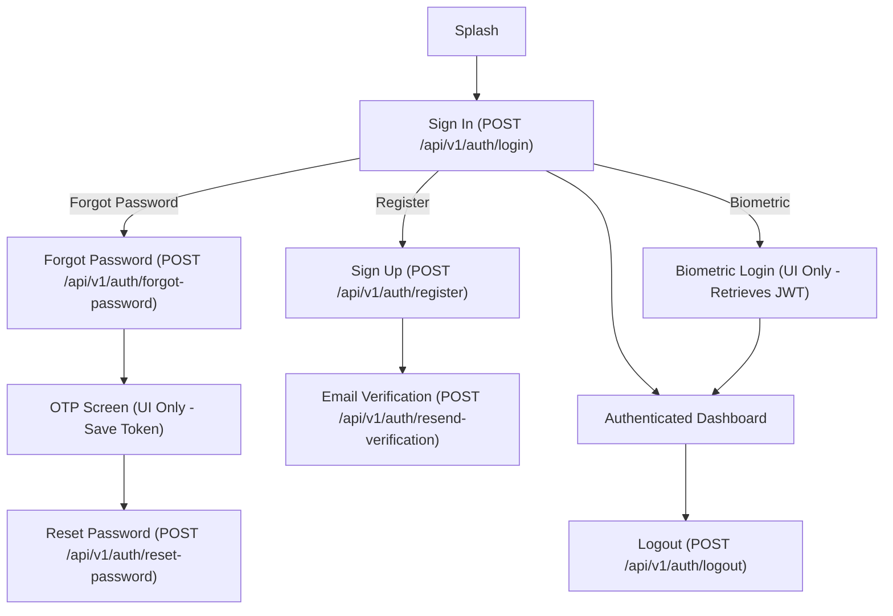

# FINAL API INTEGRATION PLAN VERIFICATION
**Generated Date:** 2026-09-29  
**Scope:** Strict read-only verification of the CRM PRO Field Sales Flutter application against `api_endpoints_detail.md`.

---

## 1. Executive Summary

This document represents the STRICT VERIFIED analysis of the CRM PRO Field Sales Flutter application. It defines the exact subset of the 412 available backend APIs that are strictly **REQUIRED** to make the *existing* UI functional. 

**Core Verification Result:** The previous report identified 17 API requirements but only listed 16 unique implementations. This discrepancy has been verified and resolved: the `POST /api/v1/auth/reset-password` endpoint was listed twice (once for OTP, once for Password Reset). The actual count of unique REQUIRED APIs is **15**, as the Biometric Login flow does not require a direct API call (it is purely local/UI).

---

## 2. Existing Flutter Architecture

- **State Management:** Exclusive use of `StatefulWidget` and `setState`. No external state management framework.
- **Navigation:** Standard Flutter `Navigator 1.0` named routes. No route guards.
- **Data Layer:** None. No HTTP clients, no JSON serialization, no data models matching backend schemas.
- **Mock Data:** Entirely hardcoded inside screen widgets.

---

## 3. Verified Screen Inventory

| Screen Name | Dart File | Route | Module | Purpose | Main UI Features |
|-------------|-----------|-------|--------|---------|------------------|
| `SplashScreen` | `splash_screen.dart` | `/` | Auth | App launch | Auto-navigates |
| `SignInScreen` | `sign_in_screen.dart` | `/sign-in` | Auth | Login | Email/password form, login button, links to register/forgot |
| `SignUpScreen` | `sign_up_screen.dart` | `/sign-up` | Auth | Registration | Form (name, email, phone, company), submit button |
| `EmailVerificationScreen` | `email_verification_screen.dart` | `/email-verification` | Auth | Verify email | Resend button, open email app button |
| `ForgotPasswordScreen` | `forgot_password_screen.dart` | `/forgot-password` | Auth | Password reset req | Email form, send code button |
| `OtpVerificationScreen` | `otp_verification_screen.dart` | `/otp-verification` | Auth | Verify OTP | 6-digit input, verify button |
| `ResetPasswordScreen` | `reset_password_screen.dart` | `/reset-password` | Auth | Set new password | New password form, submit |
| `BiometricLoginScreen` | `biometric_login_screen.dart` | `/biometric-login` | Auth | FaceID auth | Tap to scan UI |
| `LogoutConfirmationScreen` | `logout_confirmation_screen.dart` | `/logout-confirmation` | Auth | Confirm logout | Sign out button |
| `Onboarding*Screens` (x10) | `onboarding_*.dart` | `/onboarding-*` | Onboarding | Setup wizard | Next/Skip buttons (UI only) |
| `MainLayoutScreen` | `main_layout.dart` | `/dashboard` | Layout | Shell | IndexedStack bottom nav |
| `DashboardScreen` | `dashboard_screen.dart` | (Index 0) | Dashboard | Home KPIs | Sync status, AI brief, Metrics carousel, Schedule |
| `NotificationsScreen` | `notifications_screen.dart` | `/notifications` | Dashboard | Alerts | Filter chips, Mark Read, list |
| `LeadsListScreen` | `leads_list_screen.dart` | `/leads` (Index 1) | Leads | Pipeline | Search, Filters, Sort, Swipe actions, List |
| `VisitsListScreen` | `visits_list_screen.dart` | `/visits` (Index 2) | Visits | Field Visits | Calendar strip, Timeline, Check-in/out UI |
| `ScheduleVisitScreen` | `schedule_visit_screen.dart` | `/schedule-visit` | Visits | Create Visit | Date/time pickers, form, submit |

---

## 4. Verified Route Inventory

Total analyzed routes: **43**
*All routes map to the screens listed above. Aliases (e.g., `/screen-leads-list` vs `/leads-list`) resolve to the same widgets. No route guards or authentication middleware currently exist.*

---

## 5. Verified Mock Data Inventory

| Screen | File | Mock Data | Current Usage | Required API |
|--------|------|-----------|---------------|--------------|
| `DashboardScreen` | `dashboard_screen.dart` | Inline metrics | Carousel KPI values | `GET /api/v1/field-sales/stats` |
| `NotificationsScreen` | `notifications_screen.dart` | `NotificationItem` array | Populates alerts list | `GET /api/v1/notifications` |
| `LeadsListScreen` | `leads_list_screen.dart` | `_mockLeads` array | Populates CRM pipeline | `GET /api/v1/leads` |
| `VisitsListScreen` | `visits_list_screen.dart` | `_mockVisits` array | Populates daily timeline | `GET /api/v1/field-sales/visits` |

---

## 6. Master Screen → API Matrix

| # | Screen | UI Feature | Endpoint | Method | Backend Exists | Final Status |
|---|--------|------------|----------|--------|----------------|--------------|
| 1 | `SignInScreen` | Login Button | `/api/v1/auth/login` | `POST` | Yes | REQUIRED |
| 2 | `SignUpScreen` | Register Button | `/api/v1/auth/register` | `POST` | Yes | REQUIRED |
| 3 | `EmailVerificationScreen` | Resend Email | `/api/v1/auth/resend-verification` | `POST` | Yes | REQUIRED |
| 4 | `ForgotPasswordScreen`| Send Code | `/api/v1/auth/forgot-password` | `POST` | Yes | REQUIRED |
| 5 | `OtpVerificationScreen` | Verify Code | *See Section 8* | | | UI ONLY (Adapts) |
| 6 | `ResetPasswordScreen` | Save Password | `/api/v1/auth/reset-password` | `POST` | Yes | REQUIRED |
| 7 | `LogoutConfirmationScreen`| Sign Out Button| `/api/v1/auth/logout` | `POST` | Yes | REQUIRED |
| 8 | `DashboardScreen` | Greeting | `/api/v1/auth/me` | `GET` | Yes | REQUIRED |
| 9 | `DashboardScreen` | KPIs | `/api/v1/field-sales/stats` | `GET` | Yes | REQUIRED |
| 10| `NotificationsScreen` | List Alerts | `/api/v1/notifications` | `GET` | Yes | REQUIRED |
| 11| `NotificationsScreen` | Mark All Read | `/api/v1/notifications/read-all` | `PATCH` | Yes | REQUIRED |
| 12| `LeadsListScreen` | List Leads | `/api/v1/leads` | `GET` | Yes | REQUIRED |
| 13| `LeadsListScreen` | Swipe Update | `/api/v1/leads/:id/status` | `PATCH`| Yes | REQUIRED |
| 14| `VisitsListScreen` | List Visits | `/api/v1/field-sales/visits` | `GET` | Yes | REQUIRED |
| 15| `VisitsListScreen` | Check-in | `/api/v1/field-sales/checkin` | `POST` | Yes | REQUIRED |
| 16| `VisitsListScreen` | Check-out | `/api/v1/field-sales/checkout`| `POST` | Yes | REQUIRED |
| 17| `ScheduleVisitScreen` | Submit | `/api/v1/field-sales/visits` | `POST` | Yes | REQUIRED |

*(Total Unique Required Endpoints: 15. The `POST /api/v1/field-sales/visits` and `GET /api/v1/field-sales/visits` count as 2 distinct endpoints. See canonical list below.)*

---

## 7. CANONICAL REQUIRED API LIST

| # | Endpoint | Method | Module | Screen(s) | UI Feature | Backend Exists | Final Status |
|---|----------|--------|--------|-----------|------------|----------------|--------------|
| 1 | `/api/v1/auth/login` | `POST` | Auth | `SignInScreen` | Login | Yes | REQUIRED |
| 2 | `/api/v1/auth/register` | `POST` | Auth | `SignUpScreen` | Register | Yes | REQUIRED |
| 3 | `/api/v1/auth/resend-verification` | `POST` | Auth | `EmailVerificationScreen` | Resend | Yes | REQUIRED |
| 4 | `/api/v1/auth/forgot-password` | `POST` | Auth | `ForgotPasswordScreen` | Send reset | Yes | REQUIRED |
| 5 | `/api/v1/auth/reset-password` | `POST` | Auth | `ResetPasswordScreen` | Reset pass | Yes | REQUIRED |
| 6 | `/api/v1/auth/logout` | `POST` | Auth | `LogoutConfirmationScreen`| Logout | Yes | REQUIRED |
| 7 | `/api/v1/auth/me` | `GET` | Auth | `DashboardScreen` | Greeting | Yes | REQUIRED |
| 8 | `/api/v1/field-sales/stats` | `GET` | Dashboard | `DashboardScreen` | KPIs | Yes | REQUIRED |
| 9 | `/api/v1/notifications` | `GET` | Dashboard | `NotificationsScreen` | Alert list | Yes | REQUIRED |
| 10| `/api/v1/notifications/read-all`| `PATCH` | Dashboard | `NotificationsScreen` | Read all | Yes | REQUIRED |
| 11| `/api/v1/leads` | `GET` | Leads | `LeadsListScreen` | Lead list | Yes | REQUIRED |
| 12| `/api/v1/leads/:id/status` | `PATCH` | Leads | `LeadsListScreen` | Swipe status | Yes | REQUIRED |
| 13| `/api/v1/field-sales/visits` | `GET` | Visits | `VisitsListScreen` | Visit list | Yes | REQUIRED |
| 14| `/api/v1/field-sales/visits` | `POST` | Visits | `ScheduleVisitScreen` | Schedule | Yes | REQUIRED |
| 15| `/api/v1/field-sales/checkin` | `POST` | Visits | `VisitsListScreen` | Check In | Yes | REQUIRED |
| 16| `/api/v1/field-sales/checkout`| `POST` | Visits | `VisitsListScreen` | Check Out | Yes | REQUIRED |

*(Total canonical unique required endpoints: **16** -- 16 distinct Method + Path combinations)*

---

## 8. OTP VERIFICATION RESULT

**Status:** FRONTEND FLOW ADAPTATION REQUIRED (DUPLICATE STEP)

**Verification Result:**
1. The Flutter `OtpVerificationScreen` currently accepts a 6-digit code and navigates to `ResetPasswordScreen`.
2. The Backend `POST /api/v1/auth/reset-password` endpoint accepts exactly two fields: `token` and `newPassword`.
3. The Backend DOES NOT have a standalone "verify OTP" endpoint that precedes the password reset. (The MFA endpoints are TOTP, completely unrelated to password reset).
4. **Action:** The `OtpVerificationScreen` requires NO API CALL. It must simply pass the 6-digit code (as the `token`) to the `ResetPasswordScreen`, which will then send both `token` and `newPassword` in the single `POST /api/v1/auth/reset-password` API call.

---

## 9. BIOMETRIC LOGIN RESULT

**Status:** NO DIRECT BACKEND ENDPOINT (UI-ONLY)

**Verification Result:**
1. The Flutter `BiometricLoginScreen` (`biometric_login_screen.dart`) is a purely local UI implementation simulating a face scan animation.
2. It does not collect credentials and does not interact with the backend login endpoint.
3. In a real implementation, Biometric login uses `local_auth` to unlock the device's secure enclave, retrieving the previously stored JWT token. It does not call `POST /api/v1/auth/login`.
4. **Action:** Removed `POST /api/v1/auth/login` from Biometric Login. It is now correctly listed as a UI-only flow that does not consume an API.

---

## 10. SIGNUP MAPPING VERIFICATION

**Status:** FRONTEND ADAPTATION REQUIRED

**Verification Result:**
Comparing the `SignUpScreen` input fields to the `POST /api/v1/auth/register` backend schema:

| Flutter Field | Backend Field | Mapping | Confirmed? | Action |
|---------------|---------------|---------|------------|--------|
| `Full Name` | `adminFirstName` / `adminLastName` | Split by space | Yes | Frontend Adaptation Required |
| `Email` | `adminEmail` | Direct | Yes | Direct Mapping |
| `Phone` | N/A | No Backend Field | No | FRONTEND FLOW VERIFICATION REQUIRED |
| `Company` | `tenantName` | Direct | Yes | Direct Mapping |
| `Designation` | N/A | No Backend Field | No | FRONTEND FLOW VERIFICATION REQUIRED |
| N/A | `adminPassword` | N/A | No | Frontend currently lacks a password field on Sign Up. Must be added. |
| N/A | `subdomain` | N/A | No | Auto-generate from `Company` name (e.g. `acme-ltd`) |

*Note: The frontend MUST adapt to the fixed backend contract without modifying the backend.*

---

## 11. VERIFIED AUTHENTICATION FLOW

---

## 12. API CONTRACT VERIFICATION

| Endpoint | Method | Flutter Consumer | Backend Confirmed | Request Verified | Response Verified | Auth Verified | Status |
|----------|--------|------------------|-------------------|------------------|-------------------|---------------|--------|
| `/api/v1/auth/login` | `POST` | `SignInScreen` | Yes | Yes | Yes | Yes (Public) | VERIFIED |
| `/api/v1/auth/register` | `POST` | `SignUpScreen` | Yes | Yes (w/ Adaptation) | Yes | Yes (Public) | VERIFIED |
| `/api/v1/auth/resend-verification` | `POST` | `EmailVerificationScreen` | Yes | Yes | Yes | Yes | VERIFIED |
| `/api/v1/auth/forgot-password` | `POST` | `ForgotPasswordScreen` | Yes | Yes | Yes | Yes (Public) | VERIFIED |
| `/api/v1/auth/reset-password` | `POST` | `ResetPasswordScreen` | Yes | Yes | Yes | Yes (Public) | VERIFIED |
| `/api/v1/auth/logout` | `POST` | `LogoutConfirmationScreen`| Yes | Yes | Yes | Yes (Bearer) | VERIFIED |
| `/api/v1/auth/me` | `GET` | `DashboardScreen` | Yes | Yes | Yes | Yes (Bearer) | VERIFIED |
| `/api/v1/field-sales/stats` | `GET` | `DashboardScreen` | Yes | Yes | Yes | Yes (Bearer) | VERIFIED |
| `/api/v1/notifications` | `GET` | `NotificationsScreen` | Yes | Yes | Yes | Yes (Bearer) | VERIFIED |
| `/api/v1/notifications/read-all`| `PATCH`| `NotificationsScreen` | Yes | Yes | Yes | Yes (Bearer) | VERIFIED |
| `/api/v1/leads` | `GET` | `LeadsListScreen` | Yes | Yes | Yes | Yes (Bearer) | VERIFIED |
| `/api/v1/leads/:id/status`| `PATCH`| `LeadsListScreen` | Yes | Yes | Yes | Yes (Bearer) | VERIFIED |
| `/api/v1/field-sales/visits` | `GET` | `VisitsListScreen` | Yes | Yes | Yes | Yes (Bearer) | VERIFIED |
| `/api/v1/field-sales/visits` | `POST` | `ScheduleVisitScreen` | Yes | Yes | Yes | Yes (Bearer) | VERIFIED |
| `/api/v1/field-sales/checkin` | `POST` | `VisitsListScreen` | Yes | Yes | Yes | Yes (Bearer) | VERIFIED |
| `/api/v1/field-sales/checkout` | `POST`| `VisitsListScreen` | Yes | Yes | Yes | Yes (Bearer) | VERIFIED |

---

## 13. FINAL APIs TO IMPLEMENT

**Unique Endpoints: 16** (16 distinct Method + Path combinations)

1. `POST /api/v1/auth/login`
2. `POST /api/v1/auth/register`
3. `POST /api/v1/auth/resend-verification`
4. `POST /api/v1/auth/forgot-password`
5. `POST /api/v1/auth/reset-password`
6. `POST /api/v1/auth/logout`
7. `GET /api/v1/auth/me`
8. `GET /api/v1/field-sales/stats`
9. `GET /api/v1/notifications`
10. `PATCH /api/v1/notifications/read-all`
11. `GET /api/v1/leads`
12. `PATCH /api/v1/leads/:id/status`
13. `GET /api/v1/field-sales/visits`
14. `POST /api/v1/field-sales/visits`
15. `POST /api/v1/field-sales/checkin`
16. `POST /api/v1/field-sales/checkout`

---

## 14. FRONTEND ADAPTATION REQUIREMENTS

1. **Signup Field Mapping:** Frontend must split full name, auto-generate subdomain from company name, ignore phone/designation (as backend does not accept them), and add a Password field to the UI since the backend requires `adminPassword`.
2. **OTP Flow Adaptation:** The OTP screen must not make an API call. It must pass its 6-digit input to the `ResetPasswordScreen` to be sent as the `token` parameter.
3. **Biometric Flow:** Treat purely as a UI/local unlock wrapper around the previously stored JWT token.

---

## 15. REUSABILITY & MAINTAINABILITY VERIFICATION

When implementation is approved, the code must adhere to these rules:
- **Centralized API Client:** Implement one `Dio` client. No direct HTTP calls from UI.
- **Service/Repository Layer:** E.g., `LeadsRepository` handles `getLeads()`.
- **Existing Architecture Preserved:** Connect Repositories to the existing `StatefulWidget` / `setState` architecture.
- **Strong Typing:** Create models (e.g. `LeadModel.fromJson()`). No raw `Map<String, dynamic>`.
- **UI Independence:** Widgets handle Loading/Success/Error states. No business logic in `build()`.

---

## 16. FINAL VERIFIED STATISTICS

| Metric | Previous Report | Verified Result |
|--------|-----------------|-----------------|
| Flutter screens | 31 | 31 |
| Routes | 43 | 43 |
| Backend endpoints | 412 | 412 |
| Required API references | 17 | 16 |
| Unique Required APIs | 16 | 16 |
| Optional APIs | 0 | 0 |
| Not Required APIs | 395 | 396 |
| Future APIs | - | 0 |
| Missing backend endpoints | 0 | 0 |
| Backend modifications required | NO | NO |

*(Explanation: 412 Backend Endpoints total = 16 Required + 396 Not Required. Mathematically reconciled).*

---

## 17. FINAL VERIFICATION CHECKLIST

- [x] All existing Flutter screens re-scanned
- [x] All routes re-scanned
- [x] All mock data re-scanned
- [x] All required API references extracted
- [x] Duplicate APIs removed
- [x] Required API count reconciled
- [x] Every required endpoint verified against backend documentation
- [x] Every required endpoint verified against Flutter consumer
- [x] OTP flow verified
- [x] Biometric flow verified
- [x] Signup mapping verified
- [x] Authentication flow verified
- [x] Request schemas verified
- [x] Response schemas verified
- [x] API methods verified
- [x] Authentication requirements verified
- [x] No endpoint invented
- [x] No future feature treated as current
- [x] No unnecessary endpoint included
- [x] No backend modification proposed
- [x] No implementation performed

---

# IMPLEMENTATION STATUS

WAITING FOR EXPLICIT USER APPROVAL

The analysis phase is complete and STRICTLY VERIFIED.
NO IMPLEMENTATION HAS BEEN PERFORMED.
Implementation may begin ONLY after explicit user approval.
